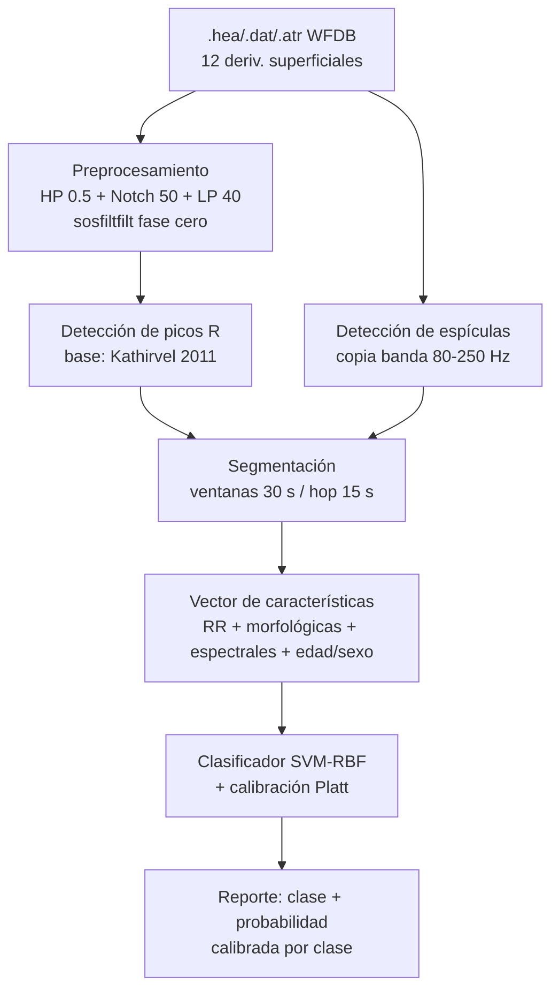

# Diseño formal del pipeline DSP — Software de Detección de Arritmias Pediátricas

**Etapa I (PPS) / F4.** Este documento especifica el pipeline completo a implementar en la
Etapa II. Toda especificación numérica está justificada con evidencia de F1/F2/F3 o con la
literatura citada (`docs/literatura/revision_bibliografica.md`).

---

## 1. Marco de decisiones (estado de las AP)

| AP | Decisión de diseño adoptada aquí | Estado |
|---|---|---|
| AP-1 | **Clasificador primario de 3 clases** (Sinusal / SVT / Paced); VT y AFL como **estudios de caso** (§5.3). Fallback documentado: usar 10 registros adultos para VT (opción 2). | PROPUESTA — requiere validación de D. Maureira |
| AP-2 | AFIB bajo SVT | PROPUESTA — validación experto |
| AP-3 | `(B` excluido ("Otro") | PROPUESTA — validación experto |
| AP-6 | Ventanas que intersecten anotaciones `~` se marcan `calidad_dudosa` (no se excluyen del baseline; se reportan aparte) | PROPUESTA |
| AP-7 | Ventanas de **30 s, hop 15 s**, solo dentro de segmentos ≥ 30 s | PROPUESTO (evidencia §5.1) |
| AP-8 | Notch fijo 50 Hz, Q moderado; su daño se mide con el protocolo §3.4 | ESPECIFICADO |
| AP-9 | `flat_frac` por ventana como feature de calidad; registros extremos monitorizados | ABSORBIDO en §6 |

## 2. Arquitectura



## 3. Preprocesamiento

Todos los filtros en configuración SOS y aplicación **`sosfiltfilt`** (fase cero, sin
distorsión de fase; requisito derivado del KPI de distorsión < 5 %).

### 3.1 Especificación de filtros

| Filtro | Tipo | Corte | Orden | Justificación |
|---|---|---|---|---|
| Paso-alto | FIR-equivalente (Butter SOS + filtfilt) | **0.5 Hz** | 4 | La deriva basal vive en 0.05–0.6 Hz (F3-D); 0.5 Hz elimina la mayor parte sin tocar ST. El amplificador ya cortó a 0.05 Hz (F3). |
| Notch | IIR (biquad) | **50 Hz, Q = 35** | 2 | Interferencia real y heterogénea (F2: pico en 3/4 registros, x001 ~10⁶× sobre el piso). Q=35 equilibra anchura de banda vs "ringing" (F3-D). Armónico 100 Hz queda fuera por el LP. |
| Paso-bajo | Butter SOS + filtfilt | **40 Hz** | 4 | Energía ECG < 40 Hz (F2 PSD). Máxima frecuencia con contenido fisiológico; maximiza SNR ante ruido mioeléctrico (visible en F2-04). |

### 3.2 Espículas de marcapasos (RS1)

Las espículas tienen contenido > 40 Hz y el LP las atenuaría. Protocolo:
1. Sobre una **copia sin filtrar** (banda 80–250 Hz por filtrado paso-banda + umbral
   adaptativo), detectar eventos tipo espícula (transientes < 10 ms).
2. Marcar como **eventos especiales** por ventana: `n_espículas`, `ritmo_espícula_bpm`.
3. Esa copia marcada acompaña a la señal filtrada; las features de espícula alimentan el
   clasificador (fuerte pista de la clase Paced).

### 3.3 Registro de respuesta en frecuencia (RF2)

`preprocess.documentar_respuesta()` genera por cada filtro: módulo y fase vs frecuencia
(PNG a `results/figuras/respuesta_frecuencia_*.png`) y las tablas numéricas
(ganancia en 0.5/40/49.5/50/50.5 Hz). Es parte del entregable de documentación, no un paso
en línea.

### 3.4 Protocolo de medición de distorsión QRS (< 5 %, KPI objetivo 1)

Sobre ≥ 200 latidos sinusales de referencia distribuidos en ≥ 10 registros limpios
(sin anotaciones `~`):
- Ventana de análisis: R ± 60 ms sobre derivación II filtrada vs sin filtrar.
- **D = 100 · ||y − x||₂ / ||x||₂** por latido (RMS relativo en la ventana).
- Criterio de aceptación: **mediana(D) < 5 %** y p90(D) < 10 %.
- Complemento: Δ duración QRS (mediana) < 5 ms tras filtrar (detección de bordes por
  umbral sobre la derivada).

## 4. Detección de picos R (RF3)

- **Algoritmo base: Kathirvel et al. 2011** — es el detector que usaron los anotadores
  del propio dataset (F3-E); reproducibilidad máxima. Implementación: transformación no
  lineal (operador de energía sqrt + cuadrado de primer diferencia) + derivador gaussiano
  de primer orden + umbral adaptativo. Fallback comparativo: Pan-Tompkins con banda
  desplazada (8–20 Hz) y período refractario acortado a 120 ms (F3-B: QRS pediátrico
  corto, FC hasta 220+ bpm en SVT — F2-04).
- Entrada: derivación II filtrada (§3); voto por mayoría sobre II + V2 si II es ruidosa
  (según `flat_frac`/RMS de alta frecuencia de la ventana).
- **Validación contra `.atr`** (todas las anotaciones de latido: N, X, /, A, V, J, …):
  coincidencia si |t_detectado − t_anotado| ≤ **100 ms**. Métricas: sensibilidad y
  precisión positiva ≥ **95 %** por registro y global (KPI del acta).

## 5. Segmentación de ventanas

### 5.1 Ventanas de entrenamiento (AP-7)

**30 s (29.310 muestras @ 977 Hz), hop 15 s**, solo dentro de un mismo segmento de ritmo
(mismo aux de `+` hasta el siguiente `+`). Evidencia (F1, pediátrico):

| Umbral seg. | Segmentos | Min retenidos | Ventanas resultantes por clase |
|---|---|---|---|
| 30 s | 291 | 726.6 / 868.3 (84 %) | Sinusal 1971, SVT 320, Paced 186, AFL 1, VT **0** |

- El corte a 30 s retiene el 84 % del tiempo con 291 segmentos; umbral menor no agrega
  ventanas de 30 s y umbral de 60 s pierde 95 min.
- Etiqueta de ventana = ritmo del segmento; ventanas que crucen una transición de ritmo
  se descartan (margen de seguridad de 1 s en cada borde).
- Ventanas con `~` de calidad → marcadas, no excluidas (AP-6).

### 5.2 Desbalance esperado (insumo §7)

Sinusal : SVT : Paced ≈ **10.6 : 1.7 : 1** a nivel de ventana. No extremo; se aborda con
pesos de clase. Las ventanas de un mismo registro están correlacionadas → la evaluación
honesta es por registro (§8).

### 5.3 Estudios de caso: VT y AFL (AP-1)

- **Ventanas de caso: 10 s, hop 5 s** dentro de segmentos ≥ 10 s. Pediátrico: AFL 1
  segmento (37.3 s), VT 5 (episodios no sostenidos, mediana 2.1 s → solo los ≥ 10 s).
- **VT**: se entrenará y reportará un detector binario adicional **solo con los 10
  registros adultos** (20 segmentos ≥ 10 s, 10 ≥ 30 s — F1), documentado como análisis
  comparativo permitido por EX3. Nunca mezclado con el conjunto pediátrico primario.
- **AFL**: análisis morfológico descriptivo (ondas F) sobre el único segmento; sin
  entrenamiento. Ambos casos se reportan con sus limitaciones en el informe final (F5).

## 6. Vector de características (RF4)

Dimensión objetivo **d ≈ 40**. Todas escaladas (z-score) dentro del fold de
entrenamiento. Edad y sexo entran como covariables (F3-B: límites normales
edad/sexo-dependientes).

| Grupo | Features (n) | Definición operativa |
|---|---|---|
| RR (10) | media, mediana, SDNN, RMSSD, pNN50, mín, máx, CV, pendiente (regresión sobre el tiempo), n_picos | Sobre intervalos entre picos detectados en la ventana |
| QRS (9) | duración media y CV, amplitudes R y S en II y V2, razón R/S, anchura media a mitad de altura | Detección de bordes por umbral en derivada, por latido |
| Onda P (3) | tasa de presencia, amplitud media, relación P/R | Búsqueda de pico en [PQ] 40–160 ms antes de R |
| Espículas (2) | n_espículas, espículas/min | §3.2 |
| Espectrales (10) | energía relativa en 5 bandas (0.5–4, 4–8, 8–16, 16–25, 25–40 Hz) en II y V2 | Welch (nperseg 2048) |
| DCT (8) | coeficientes 1–8 de la DCT-II del latido promedio (derivación II) | **Plan justificar-o-sustituir**: si la separabilidad (ANOVA/índice de Fisher, objetivo 2 del acta) no supera a la de las wavelet en la Etapa II, se sustituye por 8 coeficientes wavelet (db4, nivel 4) y se documenta (vacío F3-1) |
| Calidad (2) | `flat_frac`, RMS > 100 Hz | AP-9 |
| Demográficas (2) | edad (años), sexo (0/1) | De `*-subject-info.csv` |

Separabilidad exigida (objetivo 2 del acta): ANOVA univariada e índice de Fisher por
feature sobre el conjunto pediátrico; reporte por clase. Features con p > 0.05 y
Fisher nulo se descartan (reducción documentada).

## 7. Clasificador (RF5)

**Matriz de decisión:**

| Criterio | SVM-RBF (kernel) | Random Forest |
|---|---|---|
| Pocos samples + d media | **Fuerte** (margen máximo) | Fuerte |
| Multiclase nativo | OvR requerido | **Nativo** |
| Probabilidades | score → calibrar | predict_proba pobremente calibrado → calibrar |
| Escalado de features | Requerido (hecho en §6) | No requerido |
| Interpretabilidad | Coeficientes por clase vía OvR | Importancia de features |
| Sensibilidad a desbalance moderado | `class_weight='balanced'` | `class_weight='balanced_subsample'` |

**Decisión: SVM-RBF como primario** (coherente con RS2 del acta: "SVM con kernel RBF"),
**Random Forest como comparador** obligatorio en cada experimento. Ambos envueltos en
calibración (§8.3). Hiperparámetros: C, γ (SVM) y n_estimators, max_depth (RF) — grilla
pequeña y explícita, seleccionada solo en folds internos (§8.1).

## 8. Protocolo de validación

### 8.1 Leave-one-record-out anidado (Cawley-F3)

- **Exterior**: LORO sobre los 29 registros pediátricos (29 folds). Todo el pipeline que
  aprende parámetros (escalado, selección de features, calibración) se re-ajusta en cada
  fold con 28 registros.
- **Interior**: en cada fold, CV estratificado **agrupado por registro** (GroupKFold, 4
  grupos) para la grilla de hiperparámetros.
- Prohibido: reportar métricas del fold usado para seleccionar (sesgo de selección,
  cawley2010over).

### 8.2 Métricas (objetivo 4 del acta)

Por clase y macro: sensibilidad, especificidad, F1 (objetivo: Se/Sp global ≥ 85 %,
F1 por clase ≥ 0.80 — alcanzable en las 3 clases primarias según §5.1/§5.2;
para VT/AFL rige §5.3). Matriz de confusión agregada por ventanas y por registros
(voto mayoritario). IC bootstrap por registro (n = 29, percentil 95 %).

### 8.3 Calibración (RF6, Brier < 0.2)

- `CalibratedClassifierCV(method='sigmoid')` (Platt) — con ~2.5k ventanas la isónica
  tiende a sobreajustar (niculescu2005predicting).
- **Brier multiclase** (promedio de scores binarios one-vs-rest) reportado por fold y
  agregado; curvas de confiabilidad (reliability diagram) por clase.
- Reporte final de diagnóstico: `clase + probabilidad calibrada por clase` (RF6).

## 9. Riesgos del acta → mitigación en el diseño

| Riesgo | Mitigación aquí |
|---|---|
| RS1 calidad de señal | Features de calidad (§6), ventanas marcadas por `~` (AP-6), notch cuantificado (§3.4) |
| RS2 sobreajuste | LORO anidado, modelo de margen, features reducidas por separabilidad, grilla mínima |
| RS5 incompatibilidad de versiones | `uv.lock` fijado desde F0 |

## 10. Estructura del código (contratos)

`src/ecg_pipeline/` — esqueleto con interfaces documentadas (implementación = Etapa II):

```
src/ecg_pipeline/
├── __init__.py
├── io.py          # lectura WFDB, índice de ventanas, etiquetas
├── preprocess.py  # filtros (specs §3), espículas, distorsión QRS
├── features.py    # vector §6 + nombres estables + separabilidad
├── models.py      # SVM/RF + calibración + LORO anidado + métricas
└── report.py      # reporte de diagnóstico con certeza calibrada
```

Cada módulo declara funciones con firma tipada, contrato en docstring y
`NotImplementedError` — los KPI que verifica cada función están referenciados en su
docstring (objetivo 1: §3.4; RF3: §4; etc.).

## 11. Plan de verificación de la Etapa II

1. `uv run python scripts/validar_filtros.py` → respuesta en frecuencia + distorsión < 5 % (§3.4).
2. `uv run python scripts/validar_detector_r.py` → Se/+P ≥ 95 % vs `.atr` (§4).
3. `uv run python scripts/ejecutar_experimento.py` → LORO anidado completo; tabla de
   métricas §8.2 + Brier + confiabilidad.
4. Cada script falla (exit ≠ 0) si su KPI no se cumple.
