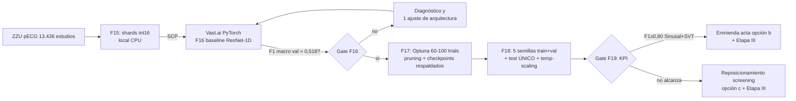

# Plan Etapa II-bis — Deep Learning sobre ZZU pECG (corpus único)

**Rama propuesta:** `dl-zzu` (desde `etapa2-corpus-combinado`) · **Fecha:** 12-oct-2026 ·
**Origen:** feedback de D. Maureira, reunión 2026-10-12
(`docs/reunion_maureira_2026-10-12.md`).

Feedback recibido (2 puntos):

1. **Usar solo el dataset con más datos — ZZU pECG** ("ZZZ" en la reunión =
   ZZU pECG, Zhengzhou): las herramientas entrenadas con datos de una población
   fallan al diagnosticar a otra población, lejana y a veces cercana.
2. **Pasar a Deep Learning + Optuna** para el ajuste de hiperparámetros:
   SVM/RF no entregaron los resultados esperados y con >13.000 estudios el
   volumen ya habilita aprendizaje profundo. Entrenar en una instancia GPU
   externa. La ejecución operativa vigente se documenta en
   [el runbook de Vast.ai](runbooks/vastai_dl.md).

---

## 1. Evidencia que motiva el cambio de enfoque

| Hecho | Cifra | Fuente |
|---|---|---|
| Techo SVM/RF tras 3 iteraciones autorizadas | F1 macro 0,518 (RF); SVT 0,35 / VT 0,43 / Paced 0,34 | `results/fase2_pipeline/experimento_corpus/` |
| Confusión estructural a 10 s con features manuales | SVT(EAT)↔sinuso-taquicardia: 87+363 registros cruzados | F14, §3.2 etapa2 |
| Domain shift entre poblaciones (histórico) | ZZU→Leipzig F1 0,36; Leipzig→ZZU 0,10 | F14, docs/etapa2_corpus_combinado.md §3.3 (evidencia purgada 13-oct) |
| Calibración (fortaleza a preservar) | Brier multiclase 0,037 (KPI ✅) | ídem |
| Corpus ZZU tras QC 100 % | 13.436 estudios / 11.643 pacientes / 500 Hz | `results/fase1_limpieza/qc_zzu/` |
| GPU local | No existe (CPU 13 GB RAM) → entrenamiento externo obligatorio | `nvidia-smi` falla |

Los dos puntos del feedback son consistentes con la evidencia propia: la mezcla
de poblaciones en entrenamiento es dañina (domain shift medido) y el clasificador
de features manuales tiene brecha estructural, no de implementación.

## 2. Decisiones de diseño (D1–D6)

**D1 — Corpus de entrenamiento: ZZU pECG exclusivamente.** Train/val/test viven
solo dentro de ZZU, agrupados por PACIENTE (11.643 niños; dos estudios del mismo
niño nunca cruzan folds). Soporte por clase, solo ZZU:

| Clase | Registros | Ventanas 10 s (hop 5 s) | Papel |
|---|---|---|---|
| Sinusal | 7.238 | 31.285 | primaria |
| Otro | 5.767 | 24.853 | clase de rechazo (D3) |
| SVT | 317 | 1.501 | primaria |
| VT | 92 | 435 | primaria débil / detector binario (B4) |
| Paced | 22 | 104 | caso de estudio / detector binario (B4) |

**D2 — Leipzig eliminado del proyecto (revisión 13-oct).** La decisión
original (validación externa una vez sobre Leipzig pediátrico) se revoca:
los datos, scripts y results de Leipzig (F1–F9, transferencia F14) fueron
purgados por decisión del equipo. El domain shift queda como evidencia
histórica documentada (etapa2 §3.3); la limitación de población se declara
en el FPS y el eventual fine-tuning con datos chilenos (Isatec/CEC) queda
como trabajo futuro.

**D3 — 'Otro' entra como 5ª clase (respuesta tentativa a B1, pendiente de
confirmación escrita).** Con DL no hay costo de features manuales y una clase de
rechazo evita que ritmos no-objetivo se fuercen a Sinusal (los 363
Se deja una ablación
con/sin 'Otro' dentro del presupuesto autorizado (§5).

**D4 — Arquitectura: 1D-ResNet sobre señal cruda filtrada.** Entrada
12×5.000 (10 s @ 500 Hz) tras la cadena F6 ya validada (HP 0,5 / notch 50 /
LP 40; distorsión morfológica 2,59 % — KPI 1). Registros de 9 derivaciones
(<7 años) mantienen el relleno en 0 de F13; normalización z-score por
derivación con estadísticos del TRAIN. Modelo tipo ResNet-1D estándar
(Strodthoff/Hannun): stem conv ancho + 3–5 bloques residuales con stride 2,
GroupNorm (seguro con batch pequeño y desbalance), GAP + cabeza lineal;
1–3 M de parámetros. Salida softmax = probabilidad por clase (reemplaza la
calibración Platt; se ajusta temperature scaling en val para conservar Brier).

**D5 — Protocolo Optuna.** Objetivo: **maximizar F1 macro en validación**
(por paciente), una única partición fija 80/10/10 por paciente estratificada
(guardada en `results/dl/splits.csv`). TPE + MedianPruner, 60–100 trials.
Espacio: profundidad 3–5 · filtros base 24–64 · kernel stem 11–25 · dropout
0–0,5 · lr 1e-4–3e-3 (log) · weight decay 1e-6–1e-2 (log) · batch {64,128,256}
· pérdida {CE ponderada, focal} con α (exponente de pesos de clase) 0,5–1,0 y
γ_focal 1–3 · label smoothing {0, 0,05, 0,1} · data augmentation
(desplazamiento temporal ±0,2 s, ganancia 0,9–1,1, deriva de línea base
0,1–0,5 Hz, dropout de derivación p≤0,1) on/off. Coseno + AdamW + precisión
mixta; máx 50 épocas, early stop paciencia 8. Test se toca UNA sola vez al
final (D6).

**D6 — Evaluación final única y comparable.** Mejor config → reentrenar con 5
semillas sobre train+val, seleccionar por val, evaluar UNA vez en test con la
batería §8.2 completa (Se/Sp/F1 por clase a nivel ventana y registro-voto,
matrices, Brier, confiabilidad, IC bootstrap) — mismo esquema de
`results/fase2_pipeline/experimento_corpus/` para la tabla comparativa SVM/RF vs DL.

## 3. Hitos F15–F19 (continúa la serie de commits)

### F15 — Empaquetado de datos para DL
`scripts/empaquetar_shards_dl.py` produce los shards; `notebooks/05_dl_colab.ipynb`
verifica los shards ya transferidos a Vast.ai. El empaquetado recorre
`results/fase2_pipeline/corpus/indice_ventanas.csv` (ZZU-only), aplica
`io.cargar_registro_zzu` + `preprocess.preprocesar` una vez por registro,
cuantiza a **int16** (1 µV/LSB) y escribe shards ~1 GB + manifiesto
(window_id, paciente, registro, clase, shard, offset). Total ≈ 7 GB con
'Otro' (~4 GB solo primarias, `--sin-otro`). Partición 80/10/10 por paciente
estratificada → `results/dl/splits.csv`; estadísticos de normalización solo
de train → `results/dl/normalizacion.json`.

Verificación (falla con exit ≠ 0): conteos == índice; reconstrucción
bit-exacta de 200 ventanas; particiones disjuntas por paciente. Los shards
permanecen fuera de git y se transfieren por SCP a la instancia Vast.ai;
manifiesto/splits/stats viven en el repo. El flujo operativo está en
`docs/runbooks/vastai_dl.md`.

### F16 — Baseline DL en Vast.ai (gate temprano)
- `notebooks/05_dl_colab.ipynb`: valida shards cargados por SCP;
  `notebooks/06_dl_baseline_colab.ipynb` ejecuta el baseline.
- Humo GPU (≤1.000 ventanas, 2 épocas): pérdida decrece y val F1 se calcula.
  Luego 1 entrenamiento completo en la GPU de Vast.ai.
- **Aceptación (gate):** F1 macro val (ZZU, por paciente) **> 0,518** (batir a
  RF). Si no: máximo 1 iteración de diagnóstico (arquitectura/loss) antes de
  escalar al equipo — misma política de cómputo que F14.

### F17 — Búsqueda Optuna (D5)
- Campaña autorizada UNA vez (§5). Guardar el journal y checkpoints fuera de
  la instancia antes de destruirla. Artefactos: `results/dl/optuna/`
  (estudios, top-10 configs, historia de trials).

### F18 — Evaluación final (D6)
- `results/dl/` con `metricas.json`, matrices por ventana y registro,
  `confiabilidad.png`, `kpi.json` (mismo esquema que `experimento_corpus`).
- Tabla comparativa SVM / RF / DL.

### F19 — Gate de decisión y cierre documental
- KPI alcanzado en Sinusal+SVT → enmienda del acta (opción b: VT/Paced como
  detectores binarios de caso de estudio, B4) con firma del experto.
- No alcanzado tras el presupuesto → reposicionamiento como screening (opción
  c: Se de arritmia + certeza calibrada, Brier ya cumple). Sin iteraciones
  adicionales sin autorización del equipo.
- Actualizar `README.md`, `docs/anotaciones_pendientes.txt` (AP-14 y cierres
  AP-1/2/3 si llegan), merge a `main` del estado validado.

## 4. Logística de cómputo

| Recurso | Uso | Límite |
|---|---|---|
| Local CPU (13 GB RAM) | F15 shards, verificaciones, figuras | sin límite |
| Vast.ai PyTorch (GPU contratada) | F16–F18 | instancia con ≥16 GB VRAM y SSH directo |
| Equipo local | shards de origen + respaldo de checkpoints | 8–10 GB |

Detalles operativos: checkpoint por época en disco de la instancia; descargar
resultados antes de destruirla o reciclarla;
`num_workers=2` + `pin_memory`; precisión mixta bf16/fp16; semilla por trial
(documentado no bit-exacto por cudnn.benchmark). El repo no agrega torch a las
dependencias base: la plantilla PyTorch de Vast.ai lo provee y `uv.lock` queda
intacto para el pipeline PDS.

## 5. Política de cómputo (extensión de la de F14)

Se solicita al equipo autorización ÚNICA por adelantado para: (a) la campaña
Optuna completa de F17 (≤ 100 trials), (b) 5 reentrenos de semillas en F18,
(c) 2 abulaciones: con/sin clase 'Otro' (D3) y ventana 10 s @ 500 Hz vs 250 Hz
(si el I/O de SCP limita). Todo lo demás (nuevas arquitecturas, más trials)
requiere autorización nueva, como en F14-bis/ter.

## 6. Calendario (12-oct → 20-dic; Etapa III adelantada ~2 semanas)

| Fechas | Hito | Verificación |
|---|---|---|
| 13–17 oct | F15 shards + transferencia SCP; F16 notebook + humo GPU | `verificacion_shards.txt` verde; loss decrece |
| 20–24 oct | F16 entrenamiento Vast.ai completo | Gate: F1 macro val > 0,518 |
| 27–31 oct | F17 campaña Optuna (noches, reanudable) | ≥ 60 trials completados |
| 03–07 nov | F17 cierre + F18 evaluación final | `results/dl/kpi.json` + comparativa |
| 10–14 nov | F19 gate + docs + merge | acta enmendada o reposicionamiento escrito |
| 17 nov–04 dic | Etapa III: FPS + demo E5 + revisión experto | PPS→FPS consistente |
| 05–20 dic | Defensa DPS + buffer | — |

## 7. Riesgos

| # | Riesgo | Mitigación |
|---|---|---|
| RS-DL1 | Instancia Vast.ai se destruye o recicla | Descargar checkpoints y logs antes de destruirla; implementar reanudación antes de F17 |
| RS-DL2 | Subida de 6,6 GB por SCP lenta | Transferencia reanudable con `rsync -avP`; no copiar ZZU crudo |
| RS-DL3 | Paced (104 ventanas) y VT (435) colapsan en DL | Ya contemplado: detectores binarios de caso de estudio (B4/F19) |
| RS-DL4 | 'Otro' heterogéneo degrada macro-F1 | Ablación con/sin 'Otro' autorizada (§5) |
| RS-DL5 | Sobreajuste al val por Optuna (selección) | Partición fija declarada, test tocado UNA vez; reportar gap val–test |
| RS-DL6 | Fuga por paciente (estudios repetidos del mismo niño) | Splits por `paciente` verificados en F15 (disjointness exit ≠ 0) |

## 8. Qué NO cambia

- Pipeline PDS F6–F13 (filtros, detector R, features) sigue siendo la espina
  dorsal del sistema y la demo E5; DL reemplaza solo el bloque clasificador F14.
- Batería de métricas §8.2 y KPIs del acta (salvo la enmienda que ya estaba
  pendiente con el experto desde antes del DL).
- Estrategia de población: entrenar en corpus público + limitación declarada +
  fine-tuning chileno futuro (carta Isatec/CEC sigue pendiente, §3 reunión).
- Convenciones de commits (F15, F16, …), resultados comprometidos junto al
  código, decisiones registradas como AP-n en `docs/anotaciones_pendientes.txt`.
